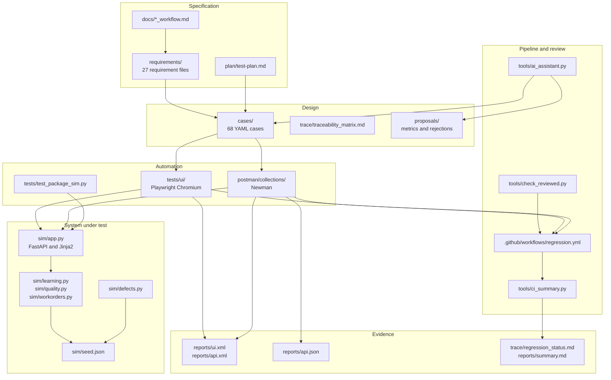

# Architecture

**Project:** Package Functional Test Lab
**Identifier:** SIMULATED – Not affiliated with Intellum, Verint, IBM TRIRIGA, or IBM Maximo.

The lab is a single chain. Each layer has a directory, a milestone, and a rule for what it is allowed to change.



## Requirements

**Directory:** `requirements/`
**Milestone:** M1
**Count:** 27 files plus `requirements/README.md`

| Prefix | Files | Topic |
| --- | --- | --- |
| `REQ-INT-001` – `REQ-INT-009` | 9 | Learning: enrollment, modules, assessment, pass, fail, completion, certificate, write contract, read contract |
| `REQ-VER-001` – `REQ-VER-008` | 8 | Quality: evaluation, form, score, threshold, coaching, acknowledgement, dispute, coaching link |
| `REQ-TRI-001` – `REQ-TRI-010` | 10 | Work: request, approval, task, assignment, in progress, time, materials, completion, closure, rework |

Each file states the business rule, cites the public source the study model used, records a simulated assumption when that source is silent, and lists acceptance criteria a case can cite. `plan/test-plan.md` assigns High or Medium risk. `docs/intellum_workflow.md`, `docs/verint_workflow.md`, and `docs/tririga_workflow.md` are the narrative diagrams those requirements come from. M1 artifacts were not rewritten when later milestones added a runtime.

The assumption register in the test plan is the oracle where a public page does not fix a number. `ASM-INT-06` is the sample pass threshold of 80.00 percent, inclusive, two decimal places, half-up. `ASM-TRI-08` is rework from `COMP` to `INPRG` when a reason is present.

## Test cases

**Directory:** `cases/`
**Milestones:** M3 and M7
**Count:** 68 YAML files

M3 designed 60 cases. Those files still say `milestone: M3` and `status: Designed`. They were not rewritten when M7 added cases. M7 added eight accepted design cases:

| Case | Requirement | Criterion |
| --- | --- | --- |
| TC-INT-022 | REQ-INT-003 | AC-2 unanswered questions contribute 0 points |
| TC-INT-023 | REQ-INT-003 | AC-4 attendance or launch with no answers |
| TC-TRI-024 | REQ-TRI-002 | AC-4 rejection without a reason stays WAPPR |
| TC-TRI-025 | REQ-TRI-005 | AC-2 supervisor may start |
| TC-TRI-026 | REQ-TRI-006 | AC-4 coworker time line is read-only |
| TC-VER-017 | REQ-VER-001 | AC-4 second in-progress evaluation |
| TC-VER-018 | REQ-VER-006 | AC-2 second acknowledgement keeps the original time |
| TC-VER-019 | REQ-VER-006 | AC-5 acknowledgement by someone else |

Each M7 file has `source: ai-draft`, `reviewed_by: "Lab reviewer"`, `status: Accepted`, and `automation_intent: not-executable`. `execution.automated` is false. The Python tools read these files with regular expressions. PyYAML is not a dependency.

`proposals/` holds `metrics.yaml` and `proposals/rejected/`. Accepted drafts are deleted from `proposals/` when the case file is written. Four rejections remain: `REQ-TRI-002-01`, `REQ-INT-008-01`, `REQ-INT-008-02`, and `REQ-TRI-005-02`.

## Simulator

**Directory:** `sim/`
**Milestone:** M2

```text
Browser or API client
        |
        v
sim/app.py          FastAPI routes, Jinja pages, /health, /test/reset
        |
        +-- sim/learning.py
        +-- sim/quality.py
        +-- sim/workorders.py
        +-- sim/defects.py
        |
        v
sim/models.py       in-memory store
        |
        v
sim/seed.json       restored by POST /test/reset
```

Pages are server-rendered. The same Python functions serve `/api/...` JSON. `POST /test/reset` replaces learners, enrollments, evaluations, work orders, certificates, and defect switches from `seed.json`.

The running state lists are smaller than the M1 workflow diagrams, and `docs/package_sim.md` is the map of that reduction.

| Workflow | Simulator rule |
| --- | --- |
| Learning | Activity is Available or Draft. Enrollment is Enrolled, In Progress, Passed, Failed, or Completed. Passed and Completed are different states. A certificate is a record. Fourth attempt is rejected. Failed may reset to Enrolled while attempts used stay below 3. |
| Quality | One `state` on the evaluation. Pending, Under Review, Acknowledged, Disputed, Coached, Completed. Score, acknowledgement time, dispute comment, and coaching note stay on that record. |
| Work | One work-order record for the request and the task. Draft, WAPPR, APPR, INPRG, WMATL, COMP, CLOSE. `CAN`, `WSCH`, `WPCOND`, and `HISTEDIT` are not states. |

`sim/defects.py` holds the six switches. They default to true in `seed.json`. A switch changes new decisions. It does not rewrite scores already stored in the seed. HTTP 409 is the illegal-transition response. HTTP 422 is a missing or invalid field. HTTP 404 is an unknown ID.

`tests/test_package_sim.py` is the simulator verification module: 10 tests covering health, the banner, reset, seed counts, legal and illegal transitions, and each defect switch. It is not the M3 catalog and it is not the Playwright or Newman suite.

## Playwright

**Directory:** `tests/ui/`
**Milestone:** M4

| Path | Role |
| --- | --- |
| `tests/ui/conftest.py` | Session-scoped Chromium server, per-test `POST /test/reset`, defect toggle |
| `tests/ui/pages/learning_page.py` | Learning page object |
| `tests/ui/pages/quality_page.py` | Evaluation page object |
| `tests/ui/pages/workorder_page.py` | Work-order page object |
| `tests/ui/test_learning.py` | 9 tests |
| `tests/ui/test_quality.py` | 8 tests |
| `tests/ui/test_workorders.py` | 9 tests |

The fixture `browser_name` returns `chromium`. When `SIM_EXTERNAL=1`, pytest uses the server CI already started on port 18765. Otherwise pytest starts Uvicorn on that port and stops it at the end of the session. `DefectControls.set_enabled` returns immediately when `SIM_FORCE_DEFECTS=on`, which leaves the seeded switches ON.

`reports/ui.xml` is the local defect-off JUnit result: 26 tests, 0 failures, 0 errors, 0 skipped. `trace/defect_detection_matrix.md` names the six tests that fail when the matching switch stays on.

## Postman

**Directory:** `postman/`
**Milestone:** M5

| Path | Role |
| --- | --- |
| `postman/collections/learning.postman_collection.json` | Learning API |
| `postman/collections/quality.postman_collection.json` | Quality API |
| `postman/collections/workorders.postman_collection.json` | Work-order API |
| `postman/environments/local.postman_environment.json` | `baseUrl` `http://127.0.0.1:18765`, `forceDefects` `false` |
| `postman/data/*.csv` | Boundary rows |
| `postman/build_collections.py` | Regenerates collection JSON, the environment, the CSV files, and the request rows in `docs/api_traceability.md` |

Collections call Package Sim. They do not call Intellum, Verint, IBM TRIRIGA, or IBM Maximo. `tests/test_postman_contract.py` checks collection shape, the environment, the CSV boundary values, the traceability list, and a Newman report with no failed assertions. That module has 5 tests.

## GitHub Actions

**Directory:** `.github/workflows/regression.yml`
**Milestone:** M6, with the M7 review gate added in front of the suites

```text
Checkout
  → Python 3.11
  → python tools/check_reviewed.py
  → Node 20
  → pip install -r sim/requirements.txt and npm install -g newman
  → playwright install --with-deps chromium
  → uvicorn sim.app:app on 127.0.0.1:18765
  → GET /health
  → pytest tests/ui
  → newman run, three collections
  → python tools/ci_summary.py
  → upload artifacts
```

Triggers: `push`, `pull_request`, `workflow_dispatch`, and `schedule` with cron `30 20 * * *` (20:30 UTC). The manual input `force_defects` defaults to `false`. The value `true` is designed to fail the job.

`tools/ci_summary.py` merges Newman JUnit and JSON, writes `reports/summary.md` and `trace/regression_status.md`, and can append the summary to `GITHUB_STEP_SUMMARY`. `--check` fails when a requirement has no case, an automated test names a missing case, or a planted defect is not wired to an assertion. `tests/test_ci_summary.py` has 3 tests around that behavior.

The workflow file was verified locally. It has not been executed on GitHub from this machine.

Artifacts in `regression-reports`: `reports/ui.xml`, `reports/api.xml`, `reports/api.json`, `reports/summary.md`, `trace/regression_status.md`, `reports/sim.log`, and `test-results/`. Playwright traces, screenshots, and videos are kept on failure.

## Reports

**Directory:** `reports/` and `trace/`

| File | What it records |
| --- | --- |
| `reports/ui.xml` | Playwright JUnit, 26 / 0 / 0 / 0 |
| `reports/api.xml` | Newman JUnit, 82 tests, 0 failures. One suite per request name |
| `reports/api.json` | Newman JSON. Assertions 138, 0 failed: learning 53, quality 37, work 48 |
| `reports/summary.md` | The two-row Pass table |
| `trace/regression_status.md` | M6 rows: requirement, case, automation, last result |
| `trace/defect_detection_matrix.md` | Switch off versus switch on for the six UI detectors |
| `docs/api_defect_matrix.md` | The same switches on the Newman requests |
| `proposals/metrics.yaml` | 14, 8, 4, 1, 1, acceptance rate 0.57 |

The eight M7 case IDs are absent from `trace/regression_status.md` because M7 did not regenerate that file.

## How a change is supposed to move

A new idea starts as text in a requirement. The drafter may propose an uncited acceptance criterion. A person accepts it into `cases/` or rejects it into `proposals/rejected/`. The review gate reads `source: ai-draft` only. An accepted case remains a design record until some later, explicit request promotes it into Playwright or Postman. The simulator rules, the 26 UI tests, and the three collections were left unchanged by M7.
