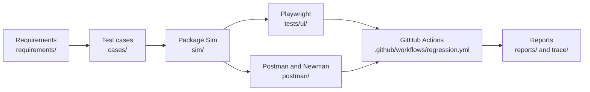

# Package Functional Test Lab

**SIMULATED – Not affiliated with Intellum, Verint, IBM TRIRIGA, or IBM Maximo.**

**Status:** Milestone M7 complete. The assistant drafts proposals only. A person accepted eight design cases and rejected four. Simulator, Playwright, and Postman behavior are unchanged. See `docs/project_completion.md`.

**Identifier:** SIMULATED

A personal portfolio lab that practices a full functional-testing chain on three simulated enterprise workflows: learning, quality management, and facilities work. Requirements, a local simulator, a YAML case catalog, browser tests, API tests, a GitHub Actions workflow, and a review-gated drafter all live in this repository.

## Simulated disclaimer

This repository is a **simulated functional testing lab**.

The workflows are study models derived only from publicly available documentation about:

- Intellum-style learning management
- Verint-style quality management
- IBM TRIRIGA and IBM Maximo real estate and facilities work orders

Nothing in this repository is a vendor product, a connector to a vendor product, or a customer implementation. The lab does not claim delivery experience, employment, partnership, certification, or access to non-public vendor systems. Where a public document leaves a rule unspecified, the lab states a **simulated assumption** and gives that assumption an identifier. Those assumptions are test-lab choices. They are not vendor requirements.

Vendor names are used only to say which public documentation the simulated workflow was studied from.

## Project summary

The lab lets a tester practice the chain that enterprise functional testing depends on:

1. Learn the workflow from public sources.
2. Write requirements that can be tested.
3. Show how a later test case, an automated check, and a CI result would trace back to each requirement.

| Milestone | What it added | State |
| --- | --- | --- |
| M1 | 27 requirements, three workflow notes, a test plan, a defect template, and the traceability strategy | Approved. Artifacts were not rewritten later. |
| M2 | Package Sim, with six planted defect switches | Complete. See `docs/package_sim.md`. |
| M3 | 60 designed YAML cases and the traceability matrix | Designed in `cases/`. The original 60 were not rewritten. |
| M4 | 26 Playwright checks on Chromium | Complete in `tests/ui/`. |
| M5 | Three Postman collections, Newman JUnit and JSON | Complete in `postman/`. |
| M6 | GitHub Actions regression, summary table, and regression status | Workflow file is in the repo and was verified locally. It has not been executed on GitHub from this machine. |
| M7 | Review-gated edge-case proposals. Eight accepted design cases. Catalog total 68. | Complete. The platform stops here. |

The eight accepted M7 cases are design records. Each has `automation_intent: not-executable`. They are not Playwright tests, Newman requests, or simulator changes.

Further reading: [PROJECT_OVERVIEW.md](PROJECT_OVERVIEW.md), [ARCHITECTURE.md](ARCHITECTURE.md), [CASE_STUDY.md](CASE_STUDY.md), [TECHNICAL_DESIGN.md](TECHNICAL_DESIGN.md), [DEMO_SCRIPT.md](DEMO_SCRIPT.md).

## Architecture



Package Sim is a FastAPI and Jinja2 application with an in-memory store. The browser suite and the API suite call that same process. `tools/ci_summary.py` writes `reports/summary.md` and `trace/regression_status.md` from the JUnit files. `tools/ai_assistant.py` reads requirements and cases and writes proposals only. A person accepts or rejects each draft. `tools/check_reviewed.py` runs in the workflow after Python setup and allows only reviewed `source: ai-draft` cases to proceed.

Detail is in [ARCHITECTURE.md](ARCHITECTURE.md) and [TECHNICAL_DESIGN.md](TECHNICAL_DESIGN.md).

## Workflow

Three study models, each tied to public documentation and then reduced to the rules Package Sim actually runs.

| Area | Study source | Path the simulator runs |
| --- | --- | --- |
| Learning | Intellum-style public documentation | Enrolled → In Progress → Passed or Failed. Passed → Completed. Pass threshold 80.00. Maximum 3 attempts. |
| Quality | Verint-style public documentation | Pending → Under Review → Acknowledged, Disputed, or Coached. Disputed → Under Review. Acknowledged or Coached → Completed. Weights A 60, B 20, C 20. Threshold 80. |
| Work | IBM TRIRIGA and IBM Maximo public documentation | Draft → WAPPR → APPR → INPRG → COMP → CLOSE, with a WMATL branch. One record is both the request and the task. |

`CAN`, `WSCH`, `WPCOND`, and `HISTEDIT` are named in the public work-order material and are not simulator states. Rework from `COMP` back to `INPRG` when a reason is present is assumption `ASM-TRI-08`.

Workflow notes: `docs/intellum_workflow.md`, `docs/verint_workflow.md`, `docs/tririga_workflow.md`.

## Technology stack

| Layer | What is in the repository |
| --- | --- |
| Simulator | FastAPI, Jinja2, Uvicorn, in-memory store, `sim/seed.json` |
| API checks | pytest and httpx in `tests/test_package_sim.py` |
| UI automation | Playwright with pytest-playwright, Chromium only, page objects under `tests/ui/pages/` |
| API automation | Postman collections, CSV boundary files, Newman |
| Pipeline | GitHub Actions on `ubuntu-latest`, Python 3.11, Node 20 |
| Reports | JUnit XML, Newman JSON, `reports/summary.md` |
| Design catalog | YAML case files read by the Python tools with regular expressions |
| Assistant | `tools/ai_assistant.py` and `tools/prompts/edge_cases.md` |

`sim/requirements.txt` pins FastAPI, Uvicorn, Jinja2, python-multipart, pytest, pytest-playwright, and httpx. The tools do not import PyYAML. The assistant does not call an external model.

## Requirements engineering

M1 produced 27 requirement files. Each file has an ID, a description, a business rule, a public source, simulated assumptions, and acceptance criteria. The inventory and risk ratings are in `requirements/README.md`. The test plan is `plan/test-plan.md`. It aligns its sections with the ideas in ISO/IEC/IEEE 29119 and states that this alignment is a lab plan, not a certification.

| Area | IDs | Count | High | Medium |
| --- | --- | --- | --- | --- |
| Intellum-style learning | REQ-INT-001 – REQ-INT-009 | 9 | 4 | 5 |
| Verint-style quality | REQ-VER-001 – REQ-VER-008 | 8 | 4 | 4 |
| TRIRIGA / Maximo-style work | REQ-TRI-001 – REQ-TRI-010 | 10 | 5 | 5 |
| **Total** | | **27** | **13** | **14** |

High-risk rules are the ones that grant or withhold a credential, a quality outcome, an acknowledgement, a work task, or a closure. Those rows were the first automation candidates.

## Package simulator

Package Sim is the system under test. Every page carries the banner `SIMULATED – Not affiliated with Intellum, Verint, IBM TRIRIGA, or IBM Maximo.` JSON responses carry `X-Simulated: true`. There is no database. `POST /test/reset` reloads `sim/seed.json`.

Seed scale: 5 learners (`LN-01` through `LN-05`), 5 evaluations (one of each quality state through Coached), and 10 work orders. `ACT-102` is an empty available activity used for new enrollments. `ACT-103` is Draft and enrollment is rejected. `TEC-01` is an active technician. `TEC-02` is inactive.

Six planted defects default to ON in the seed:

| Switch | While ON | Requirement |
| --- | --- | --- |
| `pass_mark` | A score passes only when it is greater than 80.00. Exactly 80.00 fails. | REQ-INT-004 |
| `certificate_date` | `issued_on` is one day before `completion_date`. | REQ-INT-007 |
| `quality_score` | The total is the unweighted mean of the three section percents. | REQ-VER-003 |
| `reopen_closed` | `CLOSE` to `INPRG` is accepted. | REQ-TRI-009 |
| `invalid_completion` | `APPR` to `COMP` is accepted. | REQ-TRI-008 |
| `inactive_assignment` | Inactive technician `TEC-02` can be assigned. | REQ-TRI-004 |

`POST /api/defects/{id}` with `{"enabled": false}` turns one switch off. Reset turns all six back on. A case that expects the M1 rule turns the related switch off first. With the switch left on, the designated assertion fails. That failure is the signal that the switch still breaks the rule.

Illegal transitions return HTTP 409. Missing fields return HTTP 422. Unknown IDs return HTTP 404.

Scores use half-up rounding to two decimal places. With `pass_mark` off, a rounded score of 80.00 or above passes, so 79.995 is stored as 80.00 and passes, and 79.994 is stored as 79.99 and fails. The quality threshold is inclusive at 80.00 when `quality_score` is off. Weights are A 60, B 20, C 20. Sections A 1/2, B 1/1, C 1/1 score 70.00 (Below standard) with the switch off and 83.33 (Meets standard) with the switch on.

## Playwright

`tests/ui/` is a Chromium suite with page objects for learning, quality, and work orders. Locators use `data-testid`. Each test calls `POST /test/reset` before it runs. The suite has 26 tests: 9 learning, 8 quality, and 9 work-order.

The local defect-off JUnit file `reports/ui.xml` records 26 tests, 0 failures, 0 errors, and 0 skipped. The same six tests that turn a planted switch off were run again with `SIM_FORCE_DEFECTS=on`. That setting skips the toggle, the seed stays ON, and all six failed on the correct-behavior assertion. The other 20 UI tests do not depend on a planted switch.

M7 did not re-run the full UI suite. The 26/0 result above is the stored local defect-off report.

## Postman and Newman

Three collections live in `postman/collections/`. Each has Setup, Workflow, and Boundaries folders. Setup checks `/health`, reloads the seed with `POST /test/reset`, and turns the switches that collection cares about to OFF. Workflow runs on iteration 0. Boundaries run on every CSV row.

| Collection | Data file | Boundary rows |
| --- | --- | --- |
| Package Sim Learning | `postman/data/pass_mark_boundaries.csv` | 79.99, 80.00, 80.01, 79.994, 79.995 |
| Package Sim Quality | `postman/data/quality_boundaries.csv` | Section points for 79.99, 80.00, and 80.01 |
| Package Sim Work Orders | `postman/data/work_hours_boundaries.csv` | 0, 0.01, 24, 24.01 |

`reports/api.xml` is the combined Newman JUnit report: 82 tests, 0 failures. `reports/api.json` keeps every CSV iteration. Assertion totals are learning 53, quality 37, and work 48, which is 138 assertions and 0 failed. Newman’s JUnit reporter collapses iterations to one suite per request name, so 82 versus 138 is the expected pair of counts for this defect-off run.

`--env-var forceDefects=true` skips the Disable requests. The same assertions then fail for the six planted switches. See `docs/api_defect_matrix.md` and `docs/postman.md`.

## GitHub Actions

Workflow file: `.github/workflows/regression.yml`. Name: `Regression`.

| Trigger | When |
| --- | --- |
| `push` | Every push |
| `pull_request` | Every pull request |
| `schedule` | `30 20 * * *` (20:30 UTC) |
| `workflow_dispatch` | Manual run, input `force_defects` (`false` or `true`, default `false`) |

After checkout and Python 3.11 setup, the job runs `python tools/check_reviewed.py`. A local run of that command printed `review gate passed`. The job then installs dependencies, installs Chromium, starts Package Sim on `127.0.0.1:18765`, waits for `GET /health`, runs `pytest tests/ui`, runs the three Newman collections, writes the summary with `tools/ci_summary.py`, and uploads `regression-reports`.

`force_defects` true sets `SIM_FORCE_DEFECTS=on` for pytest and passes `--env-var forceDefects=true` to Newman. Disable steps are skipped. The job is designed to fail. That failure is the demonstration that the planted switches still break the M1 rules.

The workflow file is in the repository and the local commands were checked on this machine. The workflow has not been executed on GitHub from this machine. This README does not claim a green GitHub check run.

`SIM_EXTERNAL=1` tells the UI fixtures to use the server the workflow already started. If a local shell still has `SIM_FORCE_DEFECTS=on` from a defect demo, the next Playwright run skips the turn-off clicks. Clear the variable before a defect-off run.

## AI test assistant

`tools/ai_assistant.py` is a deterministic grounded drafter. It loads `tools/prompts/edge_cases.md`, then one requirement and the cases that cite it. It drafts from that text. It does not call an external model. It writes proposals only. A person reviews every draft.

Allowed techniques: `boundary`, `negative`, `state-transition`, `decision-table`, `exploratory`.

On the evaluation run the drafter was pointed at REQ-INT-003, REQ-INT-006, REQ-INT-007, REQ-INT-008, REQ-TRI-002, REQ-TRI-005, REQ-TRI-006, REQ-VER-001, and REQ-VER-006. REQ-INT-006 and REQ-INT-007 produced no draft because every acceptance criterion was already cited.

Accept writes a new `cases/TC-*.yaml` with `source: ai-draft`, `reviewed_by`, and `automation_intent: not-executable`, and leaves `execution.automated` false. Reject stores the file under `proposals/rejected/` with `rejection_reason`. The tool refuses to overwrite an existing case file. The review gate applies to `source: ai-draft` cases. M3 catalog files have no `source` field and are left alone.

| Measure | Value |
| --- | --- |
| Proposals generated | 14 |
| Accepted | 8 |
| Rejected | 4 |
| Duplicates | 1 |
| Invalid | 1 |
| Acceptance rate | 0.57 (8 / 14) |
| Reviewed-draft rate | 0.67 (8 / 12) |
| Reviewer | Lab reviewer |

Accepted example: `TC-INT-022` / REQ-INT-003 AC-2. Unanswered questions contribute 0 points and still count in the possible points. Technique: exploratory.

Rejected example: `REQ-TRI-002-01` expected status `CAN`. The sentence is in the requirement, so terminology validation allowed it. Review rejected it because existing cases record that `CAN` is not a simulator state. Other rejections: read-only scope and PATCH of a note are already recorded on `TC-INT-018`; `started_at` is already recorded on `TC-TRI-009`.

The duplicate restated an existing REQ-INT-003 title. The invalid contrast draft introduced `biometric_signature`, which is not in that requirement or its cases. Neither file was written.

## Traceability

The chain is requirement → test case → automation → CI result. `docs/traceability_strategy.md` defines the chain. `trace/traceability_matrix.md` and `trace/regression_status.md` hold the rows. `trace/defect_detection_matrix.md` maps each planted switch to the Playwright test that fails while the switch stays on. `docs/api_traceability.md` maps requirements and M3 cases to Postman requests.

`trace/regression_status.md` was generated in M6 from `reports/ui.xml` and `reports/api.xml`. It does not list the eight M7 cases. The assistant notes that the next CI run is what would add those cases as Not run. M7 did not regenerate the file and did not execute the workflow on GitHub.

## Metrics

Local defect-off evidence in `reports/summary.md`:

| Result | Report | Tests | Failures | Errors | Skipped |
| --- | --- | --- | --- | --- | --- |
| Pass | `reports/ui.xml` | 26 | 0 | 0 | 0 |
| Pass | `reports/api.xml` | 82 | 0 | 0 | 0 |

Newman JSON assertions in `reports/api.json`: 138 total, 0 failed (learning 53, quality 37, work 48).

Local pytest, separate from the UI suite: `tests/test_package_sim.py` has 10 tests. A later combined run of the non-UI tests passed 24: 6 assistant, 3 CI summary, 5 Postman contract, and 10 API. That sentence is about those modules. It is not a second full UI run during M7.

M7 proposal metrics are in `proposals/metrics.yaml` and match the table in the assistant section.

## Repository structure

```text
package-test-lab/
├── README.md
├── PROJECT_OVERVIEW.md
├── ARCHITECTURE.md
├── CASE_STUDY.md
├── TECHNICAL_DESIGN.md
├── INTERVIEW_GUIDE.md
├── LESSONS_LEARNED.md
├── ROADMAP.md
├── DEMO_SCRIPT.md
├── RELEASE_NOTES_v1.0.md
├── SUMMARY_FOR_RECRUITERS.md
├── SUMMARY_FOR_HIRING_MANAGERS.md
├── RESUME_BULLETS.md
├── LINKEDIN_POST.md
├── requirements/          27 requirement specifications
├── plan/                  Test plan
├── docs/                  Workflows, simulator, Postman, CI, assistant, completion
├── sim/                   Package Sim
├── cases/                 60 M3 cases plus 8 accepted M7 cases
├── proposals/             Metrics and rejected drafts
├── trace/                 Matrix, defect detection, regression status
├── .github/workflows/     regression.yml
├── tests/
│   ├── test_package_sim.py
│   ├── test_postman_contract.py
│   ├── test_ci_summary.py
│   ├── test_ai_assistant.py
│   └── ui/                Playwright regression and page objects
├── postman/               Collections, environment, and CSV data
├── tools/                 ci_summary.py, ai_assistant.py, check_reviewed.py
│   └── prompts/edge_cases.md
└── reports/               JUnit, JSON, and the summary table
```

## Installation

From the lab root on Windows PowerShell. The workflow uses Python 3.11 and Node 20.

```powershell
python -m pip install -r sim/requirements.txt
python -m playwright install chromium
```

Newman is invoked with `npx` in the commands below. The workflow installs it globally with npm on the runner.

## Execution

Start the simulator for a browser or for Newman. The collections and the CI job use port 18765. Opening the site with the command in `docs/package_sim.md` and no `--port` uses Uvicorn’s default port 8000.

```powershell
python -m uvicorn sim.app:app --host 127.0.0.1 --port 18765
```

In another shell, from the lab root, clear any leftover defect flag and run the browser suite. Pytest starts Package Sim itself when `SIM_EXTERNAL` is unset, so stop the manual server first or the port is already taken.

```powershell
Remove-Item Env:SIM_FORCE_DEFECTS -ErrorAction SilentlyContinue
python -m pytest tests/ui --junitxml=reports/ui.xml
```

API regression, with the server listening on 18765:

```powershell
npx newman run postman/collections/learning.postman_collection.json -e postman/environments/local.postman_environment.json -d postman/data/pass_mark_boundaries.csv --reporters cli,junit,json --reporter-junit-export reports/learning.xml --reporter-json-export reports/learning.json
npx newman run postman/collections/quality.postman_collection.json -e postman/environments/local.postman_environment.json -d postman/data/quality_boundaries.csv --reporters cli,junit,json --reporter-junit-export reports/quality.xml --reporter-json-export reports/quality.json
npx newman run postman/collections/workorders.postman_collection.json -e postman/environments/local.postman_environment.json -d postman/data/work_hours_boundaries.csv --reporters cli,junit,json --reporter-junit-export reports/workorders.xml --reporter-json-export reports/workorders.json
```

Review gate:

```powershell
python tools/check_reviewed.py
```

Simulator unit checks:

```powershell
python -m pytest tests/test_package_sim.py
```

## Demo instructions

A five-minute interview walk-through, with timings and the PowerShell commands above, is in [DEMO_SCRIPT.md](DEMO_SCRIPT.md). The beats are requirements, the traceability matrix, a Playwright run, a Newman run, defect injection, the failing-pipeline design, and AI proposal review.

The stored defect-off reports are `reports/ui.xml`, `reports/api.xml`, and `reports/summary.md`. A `force_defects` demonstration is expected to fail those designated assertions. Leave the stored green files in place when the demo is over. `reports/README.md` says a manual defect-on run should not replace them.

## Roadmap

M1 through M7 are complete. No further platform feature is in scope. Later work, if any, stays inside this lab: review remaining uncited acceptance criteria with the same human gate, keep `tools/check_reviewed.py` in the workflow, and, if an external model is ever added, require it to emit the same proposal shape and still wait for a person to accept. The simulator, the Playwright tests, and the Postman collections stay as they are unless a reviewed case is later promoted under a new, explicit request.

See [ROADMAP.md](ROADMAP.md) and [RELEASE_NOTES_v1.0.md](RELEASE_NOTES_v1.0.md).

## License

No license file is included yet. This repository does not grant an open-source license by implication.
