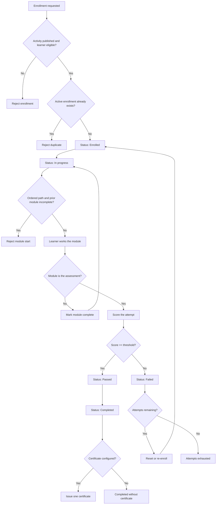

# Intellum-style learning workflow

**Document ID:** WF-INT-001
**Milestone:** M1
**Identifier:** SIMULATED

This workflow is a study model for the Package Functional Test Lab. It is derived from public Intellum documentation listed in the requirements. It is not an Intellum configuration, not an Intellum API client, and not a claim of product experience.

The lab uses this model to test enrollment, learning-module progress, assessment, pass, fail, completion, certificate generation, and a simulated enrollment API contract.

## Public behavior this model follows

The public certification operations article describes four recurring jobs: enrollment, delivery, issuance, and tracking and renewal. A certification is based on an assessment the learner must pass. Standard assessments are available on demand and are scored by the platform. Pass or fail comes from the score threshold, not from attendance. Enrollment status is the record of the outcome. Learners who do not pass can be reset or re-enrolled. A credential is issued when completion criteria are met, and it can carry a name, a unique code, an expiration length in months, and a completion identity.

The public API description says the v3 REST API reads and writes users, courses, enrollments, assessment responses, and certifications, using an OAuth application with Read, Write, or both scopes. The public page does not list the path template for enrollments. Paths in this lab are simulated identifiers.

The public data-connector description separates enrolled, completed, assessment passed, and certification earned as distinct learning facts.

## ASCII diagram

```text
                    +------------------+
                    | Activity         |
                    | published?       |
                    +--------+---------+
                             |
                    no       |        yes
              +--------------+--------------+
              |                             |
              v                             v
        [Reject enroll]              +--------------+
                                     | Enrolled     |
                                     +------+-------+
                                            |
                                            v
                                     +--------------+
                                     | In progress  |
                                     | module order |
                                     +------+-------+
                                            |
                                            v
                                     +--------------+
                                     | Assessment   |
                                     | submitted    |
                                     +------+-------+
                                            |
                         +------------------+------------------+
                         | score >= threshold                  | score < threshold
                         v                                     v
                   +-----------+                         +-----------+
                   | Passed    |                         | Failed    |
                   +-----+-----+                         +-----+-----+
                         |                                     |
                         |                          attempts left?
                         |                           |              |
                         |                          yes             no
                         |                           |              |
                         v                           v              v
                   +-----------+               +-----------+  +------------------+
                   | Completed |               | Reset /   |  | Attempts         |
                   +-----+-----+               | re-enroll |  | exhausted        |
                         |                     +-----------+  +------------------+
                         | certificate configured?
                  +------+------+
                  |             |
                 yes            no
                  |             |
                  v             v
        +-----------------+   [Completed,
        | Certificate     |    no certificate]
        | issued          |
        +-----------------+
```

## Mermaid diagram



## State transitions

Enrollment status is the outcome record. Module progress is stored on the enrollment and does not replace that status.

| From | Event | To | Guard |
| --- | --- | --- | --- |
| *(none)* | Create enrollment | Enrolled | Activity is published. Learner is eligible. No other active enrollment exists for the pair. |
| Enrolled | Start activity | In progress | Enrollment is active. |
| In progress | Complete a non-assessment module | In progress | Prior required module is complete when the path is ordered. |
| In progress | Submit assessment | Passed | Score is greater than or equal to the threshold. Attempt is stored. |
| In progress | Submit assessment | Failed | Score is below the threshold. Attempt is stored. |
| Failed | Reset or re-enroll | Enrolled | Attempts used is below the maximum. History of attempts is kept. |
| Failed | Attempt while exhausted | Attempts exhausted | Attempts used equals the maximum and no reset has occurred. Status stays Failed. |
| Passed | Completion criteria met | Completed | Required modules are complete and the assessment, when required, is Passed. |
| Completed | Issue credential | Completed, certificate linked | A certificate is configured. One certificate is created for that completion. |

`Completed` does not move back to `Enrolled` in this model. A later renewal would be a new enrollment. Renewal scheduling is described in the public article and is outside the simulated path.

## Decision points

| ID | Decision | Outcomes |
| --- | --- | --- |
| D-INT-1 | May this learner enroll in this activity? | Create `Enrolled`, or reject. |
| D-INT-2 | Is the next module unlocked? | Start the module, or reject until the prior required module is complete. |
| D-INT-3 | Is the score at or above the threshold? | `Passed` or `Failed`. Attendance without a score does not pass. |
| D-INT-4 | Are attempts remaining after a failure? | Reset or re-enroll, or leave the enrollment exhausted. |
| D-INT-5 | Are completion criteria met? | Set `Completed` and a completion time, or leave the enrollment incomplete. |
| D-INT-6 | Is a certificate configured for the activity? | Issue one certificate, or complete without one. |

## Simulated assumptions

| ID | Assumption |
| --- | --- |
| ASM-INT-01 | Creation paths are catalog self-enrollment, administrator enrollment, and rule-based assignment by group, role, or date. |
| ASM-INT-02 | One active enrollment per learner per activity. A completed historical enrollment may remain. |
| ASM-INT-03 | Only a published activity can be enrolled. |
| ASM-INT-04 | A new enrollment has status `Enrolled` and no score, completion time, or certificate. |
| ASM-INT-05 | The sample path is ordered. A content module is complete when it is marked viewed. The assessment module is complete only when the attempt is `Passed`. |
| ASM-INT-06 | The sample assessment threshold is 80.00 percent, inclusive. Comparison uses two decimal places, half-up. |
| ASM-INT-07 | The sample maximum is 3 attempts. A reset clears the current outcome and keeps attempt history. It does not delete certificates, because a failed attempt has none. |
| ASM-INT-08 | Completion for the sample certification activity requires status `Passed`. `Passed` then becomes `Completed` with one completion timestamp. |
| ASM-INT-09 | A configured certificate is issued automatically at completion. The code pattern is `SIM-CERT-{activityCode}-{year}-{sequence}`. A blank expiration length stores no expiration. The lab stores a certificate record. It does not render a PDF or call Credly or LinkedIn. |
| ASM-INT-10 | Simulated read and write routes, used only as contract names for a later milestone, are `/simulated/intellum/enrollments` and `/simulated/intellum/enrollments/{id}/assessment-responses`. These are lab names. They are not published Intellum paths. Write behavior requires a Write scope. Read behavior requires a Read scope. |
| ASM-LAB-01 | The lab does not connect to Intellum. OAuth, keys, and rate limits described on the public API page are context for later non-functional work. M1 does not test them. |

## Requirements

| ID | Topic |
| --- | --- |
| REQ-INT-001 | Enrollment |
| REQ-INT-002 | Learning modules |
| REQ-INT-003 | Assessment |
| REQ-INT-004 | Pass |
| REQ-INT-005 | Fail |
| REQ-INT-006 | Completion |
| REQ-INT-007 | Certificate generation |
| REQ-INT-008 | Enrollment API write |
| REQ-INT-009 | Enrollment API read |

## Sources

- [How to Administer a Certification Program at Scale](https://www.intellum.com/resources/blog/how-to-administer-a-certification-program-at-scale-in-intellum)
- [Certification management](https://www.intellum.com/solutions/certifications)
- [Certifications: Moving Towards Mastery Using Assessments](https://www.intellum.com/resources/blog/certifications-using-assessments)
- [LMS REST API](https://www.intellum.com/integrations/api)
- [Intellum API v3 guide](https://clients.intellum.com/student/path/643313-intellum-api-v3)
- [Certifications API (v2 resource description)](https://experience.intellum.com/student/activity/408684-certifications-api)
- [Data connector learning facts](https://www.intellum.com/integrations/data-connector)
- [Product guide listing that names User Activity Enrollment Records](https://experience.intellum.com/student/catalog/list?category_ids=17231-product-guides&page=2)
