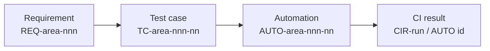

# Traceability strategy

**Document ID:** TRACE-001
**Milestone:** M1
**Identifier:** SIMULATED

This document defines the chain. M1 populates only the first node. Test cases, automation, and CI results are named so later milestones can attach to them. They are not created here.

## Chain

```text
Requirement
    |
    v
Test case
    |
    v
Automation
    |
    v
CI result
```



A manual test stops at the test case. Its automation node is `Not applicable — manual`, and it has no CI result. An exploratory session uses a charter ID and still cites one or more requirements. A charter is not required to grow an automation node.

## What each node means

| Node | Question it answers | M1 content |
| --- | --- | --- |
| Requirement | What behavior must the lab satisfy, under which assumption? | 27 requirement files. Each acceptance criterion is an anchor for a future test. |
| Test case | How will a tester or a check demonstrate that criterion? | Not created. Creating test cases is a later milestone. |
| Automation | Which test cases are executed by a repeatable check? | Not created. No tool, collection, or script is in `tools/`. |
| CI result | What did a specific run say about that check? | Not created. `reports/` has no run output. |

## Identifiers

| Node | Pattern | Example |
| --- | --- | --- |
| Requirement | `REQ-{INT\|VER\|TRI}-nnn` | `REQ-INT-004` |
| Acceptance criterion | `REQ-...` criterion number, written `AC-n` inside the requirement | `REQ-INT-004` / AC-1 |
| Assumption | `ASM-{INT\|VER\|TRI\|LAB}-nn` | `ASM-INT-06` |
| Test case | `TC-{INT\|VER\|TRI}-nnn-nn` | `TC-INT-004-01` |
| Exploratory charter | `CH-{INT\|VER\|TRI}-nnn` | `CH-VER-003` |
| Automation | `AUTO-{INT\|VER\|TRI}-nnn-nn` matching the test case it runs | `AUTO-INT-004-01` |
| CI result | Pipeline run ID plus the automation ID | `CIR-1042 / AUTO-INT-004-01` |
| Defect | `DEF-nnn` | `DEF-001` |

`nnn` matches the requirement number. The two-digit suffix distinguishes cases under one requirement. `TC-INT-004-01` is the first case for `REQ-INT-004`, not a global sequence.

## Required links

When a later milestone adds a node, the link is valid only when all of the following are true:

1. Every requirement ID in `requirements/README.md` has at least one planned test-case row.
2. Every acceptance criterion on a High-risk requirement has at least one test-case row. Medium-risk requirements have at least one row covering the requirement as a whole.
3. An automation ID points at exactly one test-case ID. A test case may have zero automation IDs when it is manual or exploratory.
4. A CI result names the automation ID, the run ID, and one of `Passed`, `Failed`, `Blocked`, or `Skipped`.
5. A failed CI result links to a defect ID or to a reason the failure was rejected as a test issue.
6. A defect links back to a requirement ID, or to `SPEC` when the specification is the object under test.

Orphan automation (a check with no requirement) is a process defect against this strategy.

## Matrix columns

Later milestones will keep one row per test case in a matrix. M1 defines the columns and leaves the test-case cells empty on purpose.

| Column | Source |
| --- | --- |
| Requirement ID | `requirements/REQ-*.md` |
| Acceptance criterion | Number inside that file |
| Assumption IDs | Assumptions that the expected result depends on |
| Risk | High or Medium, from `plan/test-plan.md` |
| Test case ID | Empty until test cases exist |
| Technique | Equivalence partitioning, boundary value analysis, decision table, state transition, exploratory, or risk-based selection note |
| Automation ID | Empty, or `Not applicable — manual` |
| CI result | Empty until a pipeline run exists |
| Defect IDs | Empty until a defect is filed |

The M1 inventory of requirement rows is `requirements/README.md`. Copy those IDs forward. Do not renumber them to make a matrix look dense.

## Coverage states

Use these words so a status report does not imply execution that did not happen.

| State | Meaning |
| --- | --- |
| Specified | The requirement file exists and has the required sections. This is the M1 state of all 27 requirements. |
| Planned | A test-case ID is reserved and not yet written. |
| Written | The test case exists and has been reviewed. |
| Automated | An automation ID executes that test case. |
| Executed | A person or a pipeline has run it and recorded a result. |
| Blocked | The run could not complete. A defect or an environment note says why. |

M1 uses **Specified** only. Moving a row to Executed without a result record is a traceability defect.

## Manual and exploratory branches

```text
Requirement --> Test case --> result recorded by a person
Requirement --> Charter -----> notes, and a defect if a rule breaks
```

Risk-based testing decides which rows earn automation first. It does not remove the requirement from the matrix when the row stays manual.

High-risk rows are the first automation candidates in a later milestone:

- Learning: `REQ-INT-004`, `REQ-INT-005`, `REQ-INT-006`, `REQ-INT-007`
- Quality: `REQ-VER-003`, `REQ-VER-004`, `REQ-VER-006`, `REQ-VER-007`
- Work: `REQ-TRI-002`, `REQ-TRI-003`, `REQ-TRI-008`, `REQ-TRI-009`, `REQ-TRI-010`

## Specification changes

If an assumption changes, the change is edited in the requirement and in the assumption register in `plan/test-plan.md` together. Test cases that cite the old assumption ID are reviewed before the next run. A CI result from before the change remains historical. It is not edited to match the new rule.

## What M1 deliberately leaves blank

- No `TC-*` files
- No `AUTO-*` implementations
- No `CIR-*` records
- No claim that any requirement has been verified by execution
