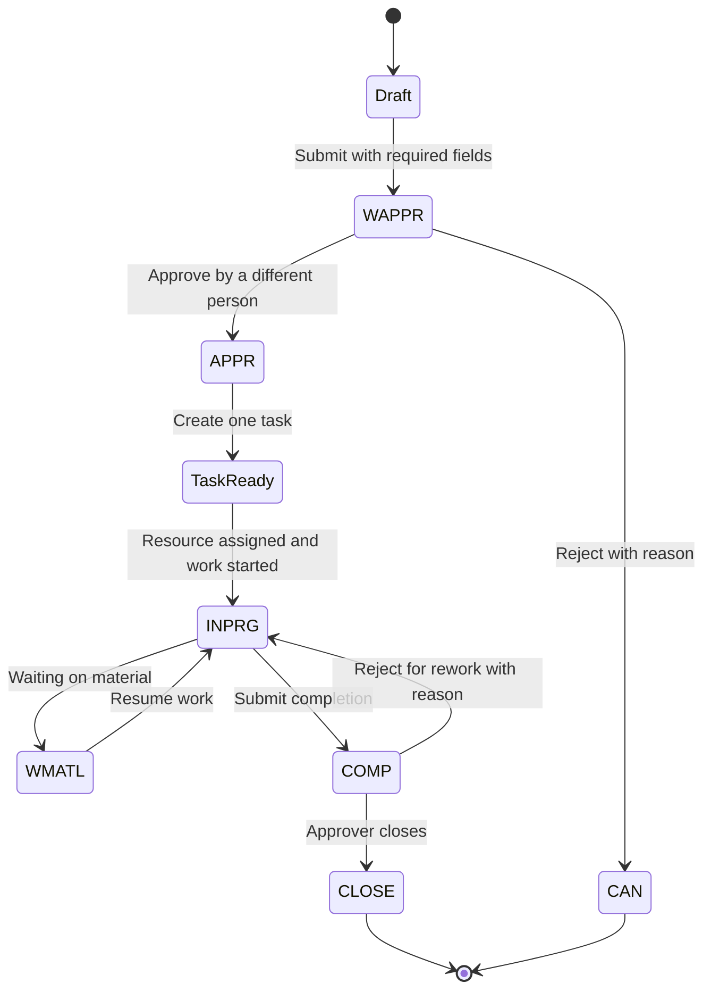

# TRIRIGA / Maximo-style work workflow

**Document ID:** WF-TRI-001
**Milestone:** M1
**Identifier:** SIMULATED

This workflow is a study model for the Package Functional Test Lab. It joins two public IBM stories and labels the join as a simulation.

- **IBM TRIRIGA** public service-management documentation describes corrective maintenance: a person submits a service request, the request is approved, a service plan creates and assigns work, and a technician accepts the task, records time and materials, and completes it. A reviewer can send unsatisfactory work back for rework or accept it and close it. The requestor is notified when corrective work is approved complete.
- **IBM Maximo** public work-order documentation names the status codes used in this lab (`WAPPR`, `APPR`, `INPRG`, `WMATL`, `COMP`, `CLOSE`, `CAN`) and publishes the allowed status changes for a standard work order. It also describes reporting labor and material actuals on an approved work order.

TRIRIGA and Maximo are different products. This lab does **not** claim that a TRIRIGA status has the same name as a Maximo status. The status words below are the lab’s simulated vocabulary, chosen because Maximo publishes an explicit transition table and TRIRIGA publishes the facilities process. The TAS connector documentation is cited only as public evidence that IBM describes the two products working together. This repository does not implement that connector.

One transition is an intentional deviation: rework from `COMP` back to `INPRG`. The Maximo table lists `CLOSE` as the successor of `COMP`. The TRIRIGA service process sends unsatisfactory submitted work back for rework. `ASM-TRI-08` records that deviation. Testers must not “fix” it by silently using the Maximo table, and they must not describe it as a Maximo feature.

## Public behavior this model follows

A self-service user or a contact-center agent creates a request against a request class. The request class is associated with one service plan. The service plan’s task template creates the task, and its assignment rule either assigns a service provider or leaves the task to be assigned another way. Technicians see tasks, accept unassigned work, log time, add parts, and complete tasks. Completed tasks that are not closed can still be edited. Closed tasks are read-only. After approval of the performed work, the requestor is notified.

Maximo: `WAPPR` is waiting for approval. `APPR` means the work can begin and actuals can be reported. `INPRG` means physical work is in progress. `WMATL` means materials must arrive before the work can be performed. `COMP` means the physical work is finished. `CLOSE` finalizes the work order and makes it a history record. `CAN` means canceled. A work order that is in progress, or that already has actuals, is not canceled.

## ASCII diagram

```text
Request draft
    |
    | required fields present
    v
  WAPPR  --reject + reason-->  CAN     (no task)
    |
    | approver, not the requester
    v
  APPR
    |
    | service plan creates exactly one task
    v
Task APPR
    |
    +-- assignment rule assigns a person, or a technician accepts it
    |
    v
Task APPR + resource
    |
    | start work
    v
  INPRG  <-------- resume ---------  WMATL
    |                                 ^
    | wait for material               |
    +---------------------------------+
    |
    | technician submits physical completion
    v
  COMP  (actuals still editable)
    |
    +---------------------------+
    | approve, approver role    | reject + reason   [ASM-TRI-08 deviation]
    v                           v
  CLOSE                     INPRG
  read-only                 time and materials kept
  parent request closed
  requestor notification recorded
```

## Mermaid diagram



`TaskReady` in the diagram is `APPR` with a task record. It is not an extra status code. The task remains `APPR` until work starts.

## State transitions

### Service request

| From | Event | To | Guard |
| --- | --- | --- | --- |
| Draft | Save | Draft | Required fields may be missing. |
| Draft | Submit | WAPPR | Request class, requester, building, and description are present. |
| WAPPR | Approve | APPR | The approver is not the requester. |
| WAPPR | Reject | CAN | A reason is present. No task is created. |
| APPR | Task closed | CLOSE | The child task has reached `CLOSE`. The requestor notification is recorded. |

### Work task

| From | Event | To | Guard |
| --- | --- | --- | --- |
| *(none)* | Approved request | APPR | Exactly one task, linked to the request. A second approval does not create another task. |
| APPR | Auto-assign, dispatch, or accept | APPR | A resource is set. A second technician cannot accept an assigned task. |
| APPR | Start | INPRG | A resource is set. `started_at` is stored. |
| APPR or INPRG | Wait for material | WMATL | The waiting reason is stored. |
| WMATL | Resume | INPRG | The resource is still assigned. |
| INPRG | Submit completion | COMP | `completed_at` is stored. Actuals remain editable. The requestor is not notified yet. |
| COMP | Approve closure | CLOSE | The actor has the approver role and is not required to be the technician. The task becomes read-only. |
| COMP | Reject for rework | INPRG | A reason is present. `completed_at` is cleared. Time and material lines remain. See ASM-TRI-08. |

### Actuals

| Event | Allowed task status | Guard |
| --- | --- | --- |
| Add time | APPR, INPRG, WMATL, COMP | Hours greater than 0 and at most 24.00 on one entry. The author does not edit another person’s time line. |
| Add material | APPR, INPRG, WMATL, COMP | Quantity greater than 0. |
| Add time or material | WAPPR, CLOSE, CAN | Rejected. |

## Decision points

| ID | Decision | Outcomes |
| --- | --- | --- |
| D-TRI-1 | Does the draft have the required fields? | Submit to `WAPPR`, or remain a draft. |
| D-TRI-2 | Does a different person approve? | `APPR`, or reject the self-approval. A rejection with a reason ends at `CAN` and creates no task. |
| D-TRI-3 | What is the service-plan assignment rule? | Auto-assign the configured person, or leave the task unassigned for dispatch or technician accept. |
| D-TRI-4 | Has a resource been assigned before work starts? | Move to `INPRG`, or reject the start. |
| D-TRI-5 | Is the task waiting on material? | Move to `WMATL`, or continue in `INPRG`. |
| D-TRI-6 | Did the approver accept the completed work? | `CLOSE`, notify the requestor, and close the parent request. Otherwise return to `INPRG` for rework. |

## Documented Maximo transitions outside this simulated path

IBM’s public table allows more changes than this corrective-maintenance path uses. The following are **recognized and not simulated**. Tests of this lab should expect the lab to reject them, and the expected result must cite this section so the rejection is not mistaken for ignorance of the public table.

- Statuses `WSCH`, `WPCOND`, and `HISTEDIT`
- `COMP` going only to `CLOSE` on a standard Maximo work order (the lab adds rework instead)
- Skipping from `WAPPR` directly to `COMP` or `CLOSE`
- Canceling a task that is `INPRG` or that already has actuals (the public rule is “cannot cancel”; the lab simply does not offer task cancel)

`WMATL` to `COMP` is allowed by the public Maximo table. The lab does not offer that shortcut. Completion is accepted from `INPRG` only (`ASM-TRI-07`).

## Simulated assumptions

| ID | Assumption |
| --- | --- |
| ASM-TRI-01 | Status codes are the Maximo names listed above, applied to a TRIRIGA-style corrective request and task. This is a lab vocabulary, not a statement that the products share codes. |
| ASM-TRI-02 | Required submit fields are request class, requester, building, and description. |
| ASM-TRI-03 | The requester cannot approve their own request. |
| ASM-TRI-04 | Sample service plan `SIM-PLAN-CORRECTIVE` creates exactly one task when the request reaches `APPR`. |
| ASM-TRI-05 | The lab implements two assignment rules from the public TRIRIGA list: Auto-Assign to the person configured on the plan, and Do not Assign. The other public rules are named in the source and are not simulated. |
| ASM-TRI-06 | Time and material quantities are records only. The lab has no inventory balance, reservation engine, or purchase request. `CLOSE` sets `reservations_released` true as a recorded effect of the public Maximo close behavior, without moving stock. |
| ASM-TRI-07 | The happy path is Draft, `WAPPR`, `APPR`, `INPRG`, `COMP`, `CLOSE`, with `WMATL` as a branch from `APPR` or `INPRG` back to `INPRG`. Completion is submitted from `INPRG` only. |
| ASM-TRI-08 | Rejection of `COMP` returns the task to `INPRG`, keeps actuals, clears `completed_at`, and requires a reason. This follows the public TRIRIGA rework description and **differs** from the Maximo rule that `COMP` changes to `CLOSE` only. |
| ASM-TRI-09 | Closure writes a requestor notification record and closes the parent request. The lab does not send email and does not present a survey. A `survey_due` flag is stored when the request class is marked survey-enabled. |
| ASM-LAB-01 | The lab does not connect to IBM TRIRIGA, IBM Maximo, or the TAS connector. |

## Requirements

| ID | Topic |
| --- | --- |
| REQ-TRI-001 | Service request |
| REQ-TRI-002 | Approval |
| REQ-TRI-003 | Task creation |
| REQ-TRI-004 | Task assignment |
| REQ-TRI-005 | Work in progress |
| REQ-TRI-006 | Time entry |
| REQ-TRI-007 | Material entry |
| REQ-TRI-008 | Completion |
| REQ-TRI-009 | Closure |
| REQ-TRI-010 | Rework after rejection |

## Sources

- [IBM TRIRIGA Application Suite: Maintenance and Service Management (PDF)](https://www.ibm.com/docs/en/SSFCZ3_11.6/pdf/pdf_tri_maint_service_mng.pdf)
- [IBM Maximo work order statuses](https://www.ibm.com/docs/en/maximo-manage/cd?topic=orders-work-order-statuses)
- [Reporting actuals for work orders](https://www.ibm.com/docs/en/maximo-manage/cd?topic=reporting-actuals-work-orders)
- [Actuals on work orders](https://www.ibm.com/docs/en/maximo-manage/cd?topic=overview-actuals-work-orders)
- [Material availability status on work orders](https://www.ibm.com/docs/en/maximo-manage/cd?topic=statuses-material-availability-status-work-orders)
- [TRIRIGA Application Suite connector for Maximo](https://www.ibm.com/docs/en/tas/11.6.0?topic=integrating-tririga-application-suite-connector-maximo)
- Public customer training manual, State of Arizona ADOA/GAO, *TRIRIGA Facilities Management — Service Tech* (secondary illustration of assign, perform, submit, reject, and close): [PDF](https://gao.az.gov/sites/default/files/2022-05/TRIRIGA%20Facilities%20Management%20-%20Service%20Tech%20V2_0.pdf)
