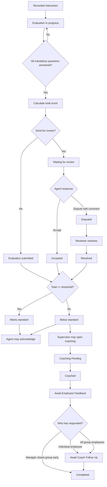

# Verint-style quality workflow

**Document ID:** WF-VER-001
**Milestone:** M1
**Identifier:** SIMULATED

This workflow is a study model for the Package Functional Test Lab. It is derived from public Verint quality and coaching documentation. It is not a Verint tenant, not a form-designer export, and not a claim of product experience.

The lab uses this model to test interaction evaluation, the evaluation form, score calculation, a score threshold, coaching, and agent acknowledgement.

## Public behavior this model follows

Public evaluation help says an evaluator reviews a recorded interaction from the employee’s perspective. An assessment, in that same help, is a separate review from the customer’s perspective. This lab models the employee evaluation only.

On submit, the help says the form’s scores are calculated and the evaluation is attached to the interaction. Submit can also send the evaluation for review, which sets the status to Waiting for Review. The fill-out help lists these evaluation statuses: Evaluation in progress, Evaluation submitted, Waiting for review, Accepted, Disputed, and Resolved.

Public scoring help describes a percentage scoring method in which a component’s final score is its relative score times its base percentage. Scoring rules may decrease a score and still respect a baseline. The lab’s arithmetic for a sample form is an assumption, because a tenant’s form is configured rather than fixed by the help page.

Public form-management help says a form can allow an agent to acknowledge a scored evaluation, and can allow acknowledgement with appeal.

Public coaching help describes this session path: create the session, set a date (or leave it Pending when workforce scheduling is used), mark it Coached, add a meeting summary and move to Await Employee Feedback, collect employee feedback until the status becomes Await Coach Follow Up, then grade the session and set Completed. A manager may set a group session to Completed before every employee responds. Reviewer approval leaves the status at Completed.

The public quality datasheet and coaching product page tie coaching to evaluation scores, interactions, and KPIs.

## ASCII diagram

```text
Interaction recorded
        |
        v
+-------------------+
| Evaluation        |
| in progress       |
+---------+---------+
          |
          | mandatory questions complete?
          v
+-------------------+
| Score calculated  |
+---------+---------+
          |
          +------------------------------+
          | Submit                       | Submit and send for review
          v                              v
+-------------------+          +-------------------+
| Evaluation        |          | Waiting for       |
| submitted         |          | review            |
+---------+---------+          +----+----------+---+
          |                         |          |
          |                        Accept    Dispute
          |                         |          |
          |                         v          v
          |                    +---------+  +----------+
          |                    | Accepted|  | Disputed |
          |                    +---------+  +----+-----+
          |                                    |
          |                                    | reviewer resolves
          |                                    v
          |                               +----------+
          |                               | Resolved |
          +---------------+---------------+
                          |
                          v
                 +------------------+
                 | Total >= 80.00? |
                 +--------+---------+
                     |         |
                    yes        no
                     |         |
                     v         v
               Meets standard  Below standard
                     |         |
                     |         +---- optional required-by-policy coaching
                     v
            Agent may acknowledge
            a visible scored evaluation


Coaching session, individual path

Pending --> Coached --> Await Employee Feedback
                              |
                              | employee feedback
                              v
                    Await Coach Follow Up --> Completed
```

## Mermaid diagram



## State transitions

### Evaluation

| From | Event | To | Guard |
| --- | --- | --- | --- |
| *(none)* | Start evaluation | Evaluation in progress | Interaction and employee exist. Evaluator selects a form. |
| Evaluation in progress | Save answers | Evaluation in progress | Partial answers are allowed. |
| Evaluation in progress | Submit | Evaluation submitted | Every mandatory question has an answer. Score is stored. |
| Evaluation in progress | Submit and send for review | Waiting for review | Same guard as submit. |
| Waiting for review | Agent accepts | Accepted | The actor is the evaluated employee. Score is unchanged. |
| Waiting for review | Agent disputes | Disputed | At least one question is named and a comment is present. |
| Disputed | Reviewer resolves | Resolved | The actor is a reviewer and is not the evaluated employee. Every disputed answer is resolved. |
| Evaluation submitted, Accepted, or Resolved | Agent acknowledges | Same status, acknowledged | The form allows acknowledgement. The evaluation is scored and visible to the agent. |

An evaluation in progress cannot be acknowledged, accepted, or disputed.

### Coaching

| From | Event | To | Guard |
| --- | --- | --- | --- |
| *(none)* | Create session | Pending | Employee, or a group, is named. A date may be unset while scheduling is pending. |
| Pending | Session held | Coached | The coach records that the meeting occurred. |
| Coached | Add meeting summary | Await Employee Feedback | The summary is present. |
| Await Employee Feedback | Required feedback arrives | Await Coach Follow Up | The individual employee has responded, or every group employee has responded. |
| Await Employee Feedback | Manager completes a group session | Completed | The session is a group session. The manager records the early completion. |
| Await Coach Follow Up | Coach grades the session | Completed | A grade is present. |
| Completed | Reviewer approves | Completed | Status does not change. |

Workforce-management auto-scheduling and KPI-alert auto-creation are public creation paths. The lab records them as named inputs that still produce `Pending`. It does not model a scheduling product.

## Decision points

| ID | Decision | Outcomes |
| --- | --- | --- |
| D-VER-1 | Are mandatory questions complete? | Allow submit, or keep the evaluation in progress and identify the missing question. |
| D-VER-2 | Was the form sent for review? | `Evaluation submitted`, or `Waiting for review`. |
| D-VER-3 | Does the agent accept or dispute? | `Accepted`, or `Disputed`. |
| D-VER-4 | Is the total at or above the threshold? | Meets standard, or Below standard. The raw score is kept either way. |
| D-VER-5 | May this agent acknowledge? | Record acknowledgement, or reject because the evaluation is in progress, hidden, or acknowledgement is disabled. |
| D-VER-6 | Has the coaching feedback rule been met? | Move to Await Coach Follow Up, stay waiting, or, for a group, allow the manager to complete early. |

## Simulated assumptions

| ID | Assumption |
| --- | --- |
| ASM-VER-01 | The lab evaluates one employee interaction with a manual form. Customer-perspective assessments, speech analytics, and automated question scoring are outside the model. |
| ASM-VER-02 | Sample form `SIM-QM-001` has three sections with base percentages 60, 20, and 20. Questions are Yes/No. Yes earns the question’s points. No earns 0. Section contribution is the section’s percent of points earned, multiplied by its base percentage, divided by 100. The total is the sum of the three contributions, clamped to 0 through 100. This formula is the lab’s reading of percentage scoring for one sample form. |
| ASM-VER-03 | The sample threshold is 80.00 inclusive. A total of 80.00 meets the standard. A total of 79.99 is below standard. The threshold does not rewrite the raw score. |
| ASM-VER-04 | Acknowledgement stores the agent and the time of the first acknowledgement. A repeat acknowledgement does not change that time and does not change the score or the evaluation status. |
| ASM-VER-05 | A dispute needs a question reference and a comment. The evaluated employee cannot resolve the dispute. |
| ASM-VER-06 | A below-standard evaluation may be linked to a coaching session. The link does not change the evaluation score. Coaching an evaluation that meets the standard is allowed and is not required. |
| ASM-VER-07 | Group early-completion is allowed only for a group session, and only by a manager, matching the public coaching note. The lab does not invent extra statuses beyond Pending, Coached, Await Employee Feedback, Await Coach Follow Up, and Completed. |
| ASM-LAB-01 | The lab does not connect to Verint. |

## Requirements

| ID | Topic |
| --- | --- |
| REQ-VER-001 | Interaction evaluation |
| REQ-VER-002 | Evaluation form |
| REQ-VER-003 | Score calculation |
| REQ-VER-004 | Score threshold |
| REQ-VER-005 | Coaching session |
| REQ-VER-006 | Agent acknowledgement |
| REQ-VER-007 | Review and dispute |
| REQ-VER-008 | Coaching link to an evaluation |

## Sources

- [Perform an evaluation/assessment](https://wfo.mon2.verintcloudservices.com/onlinehelp/en_us/QM/QM/Perform_an_evaluation_assessment.htm)
- [Form fill-out area](https://wfo.mon2.verintcloudservices.com/onlinehelp/en_us/QM/Fillout.htm)
- [Scoring methods](https://wfo.mon2.verintcloudservices.com/onlinehelp/en_us/QM/QM/Scoring_methods.htm)
- [Scoring rules](https://wfo.mon2.verintcloudservices.com/onlinehelp/en_us/QM/QM/Scoring_rules.htm)
- [Manage evaluation forms](https://www.wfohelp.com/doc/Content/user-guides/application-management/evaluation-form-manager.htm)
- [Recommended workflow: Create a coaching session](https://wfo.mon2.verintcloudservices.com/onlinehelp/en_us/coaching/CoachingUser/coach_ug_Workflow_create_session.htm)
- [Verint Quality datasheet](https://www.verint.com/wp-content/uploads/quality-management-datasheet.pdf)
- [Verint Coaching and Learning](https://www.verint.com/coaching-and-learning/)
- [5 Steps to Resolve Agent Evaluation Disputes](https://www.verint.com/blog/5-steps-to-resolve-agent-evaluation-disputes/)
